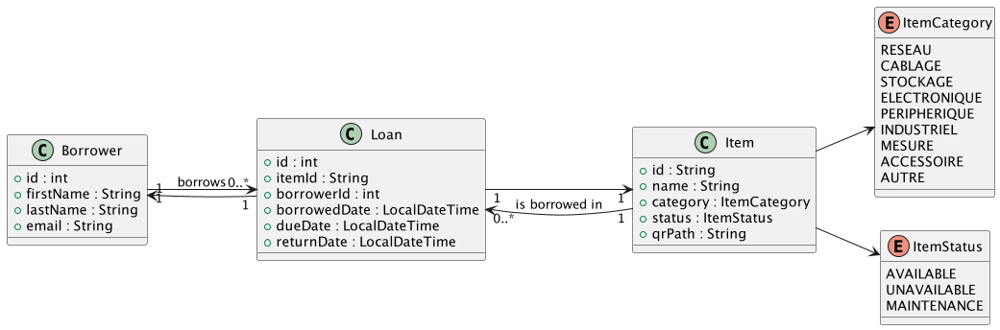

# QuickBorrow - Gestion d'Inventaire par QR Code

## 1. Description des besoins

L'objectif est de développer une application robuste pour la gestion du stock et du prêt de matériel technique (PCs, kits Arduino, capteurs, etc.) au sein d'un laboratoire ou d'une école.

**Problématique :** La saisie manuelle lors des emprunts est source d'erreurs, de pertes de données et de lenteur administrative.
**Solution :** Automatiser le suivi du matériel via des étiquettes QR code uniques associés à chaque item et une douchette USB (D5100Y).

L'application permet :

* L'enregistrement du matériel et des emprunteurs (étudiants/profs).
* La génération et l'exportation de QR codes pour chaque matériel enregistré.
* Le scan rapide pour effectuer un prêt ou un retour instantanément.
* Une navigation intuitive via un menu centralisé (Dashboard).

---

## 2. Modèle de Données (Schéma SQL)

La base de données **SQLite** est structurée autour de trois tables principales pour assurer l'intégrité référentielle et un historique complet :

### Table `items` (Le Matériel)

* `id` (PK, String) : Identifiant unique contenu dans le QR code.
* `name` (String) : Nom de l'objet.
* `category` (String) : Catégorie de matériel.
* `status` (String) : État actuel (AVAILABLE, UNAVAILABLE, MAINTENANCE).
* `qr_path` (String) : Chemin local vers l'image du QR code généré.

### Table `borrowers` (Les Emprunteurs)

* `id` (PK, Integer) : ID unique de l'étudiant ou du professeur.
* `first_name` (String) : Prénom.
* `last_name` (String) : Nom de famille.
* `email` (String) : Adresse de contact pour les relances.

### Table `loans` (Journal des Emprunts)

* `id` (PK, Auto-increment) : ID unique de la transaction.
* `item_id` (FK) : Référence à l'objet concerné.
* `borrower_id` (FK) : Référence à la personne qui emprunte.
* `borrowed_date` (DateTime) : Date et heure de sortie.
* `due_date` (DateTime) : Date limite de retour.
* `return_date` (DateTime, nullable) : Date et heure de retour (null si non encore retourné).

---

## 3. Architecture Logicielle & Diagramme de Classes

L'application respecte les principes **SOLID** et l'architecture **MVC**, afin de garantir une séparation claire entre l'interface utilisateur et la logique métier.

### Organisation du Projet

* **controller** :
  Chaque contrôleur est associé à une vue JavaFX (FXML) :
  * `DashBoardController`
  * `InventoryController`
  * `HistoryController`
  * `UsersController`

* **model** :
  Contient les classes métier principales :
  * `Item`
  * `Borrower`
  * `Loan`
  * `ItemCategory`
  * `ItemStatus`

* **repository** :
  Gestion de l'accès aux données (pattern Repository) : 
  * `ItemRepository` / `ItemRepositoryImpl`
  * `BorrowerRepository` / `BorrowerRepositoryImpl`
  * `LoanRepository` / `LoanRepositoryImpl`

  Ce module assure la communication avec la base de données SQLite.

* **service** :
  Logique métier de l'application :
  * `ItemService`
  * `BorrowerService`
  * `LoanService`
  * `QRService` (génération des QR codes via ZXing)

* **util** :
  Classes utilitaires :
  * `ConnectionManager` (gestion de la connexion JDBC)
  * `SceneManager` (navigation entre les vues JavaFX)
  * `VirtualThreadExecutor` (gestion des threads virtuels)

* **Main** :
  Point d'entrée de l'application JavaFX (`Main.java`)

---

### Diagramme de classes

Le diagramme suivant représente l’architecture globale du système et les relations entre les principales entités du projet.

---

## 4. Interfaces FXML (Vues et Navigation)

L'interface utilisateur est organisée en 4 vues principales, interconnectées et gérées via JavaFX.

### Vue 1 : DashboardView (Home)

Le Dashboard centralise les principales fonctionnalités de l’application.

- **Scan de matériel** : permet de scanner un item pour faciliter un emprunt, un retour ou consulter sa fiche détaillée.
- **Ajout rapide d’item** : formulaire simplifié pour enregistrer rapidement un nouveau matériel.
- **Statistiques en temps réel** :
    - Emprunts en cours
    - Emprunts en retard
    - Emprunts du jour
    - Retours du jour

---

### Vue 2 : InventoryView

Cette interface permet la gestion complète du stock de matériel.

- **Affichage du stock** : tableau listant l’ensemble des items.
- **Recherche intelligente** : permet de localiser rapidement un item.
- **Filtres avancés** : filtrage par catégorie et par état.

#### Actions disponibles :
- **Création d’un item**
- **Mise à jour d’un item** (catégorie et statut uniquement)
- **Suppression d’un item**

---

### Vue 3 : UserView

Cette interface permet la gestion et la consultation des emprunteurs.

- **Recherche utilisateur** : permet de retrouver rapidement un utilisateur.
- **Ajout d’un utilisateur**
- **Suppression d’un utilisateur**

Lors de la sélection d’un utilisateur, un panneau détaillé affiche :

- **Identité** : nom, prénom, email
- **Emprunts en cours**
- **Historique récent**

---

### Vue 4 : HistoryView

Cette interface affiche l’ensemble des transactions liées aux emprunts.

Une fonctionnalité de recherche permet de filtrer les enregistrements.

Chaque ligne correspond à un emprunt contenant :

- **Identifiant de l’item**
- **Identifiant de l’emprunteur**
- **Date de début**
- **Date d’échéance**
- **Date de retour** (vide si non retourné)
- **Statut** (PRÊT EN COURS ou REMIS)

---

## 5. Multithreading & Réactivité

L'application utilise des mécanismes de multithreading afin de garantir une interface fluide et réactive.

- **Accès à la base de données** : les opérations de lecture et d’écriture sont exécutées sur des Virtual Threads afin d’éviter le blocage de l’interface.
- **Génération des QR codes** : traitement effectué de manière asynchrone pour éviter les freezes lors de la création et de l’écriture sur disque.
- **Mise à jour de l’interface utilisateur** : toute modification de l’UI est effectuée via `Platform.runLater` pour respecter le thread JavaFX principal.

---

## 6. Plan de Tests (JUnit 5, Mockito, JaCoCo & SonarQube)

Une couverture de tests supérieure à **80%** est visée sur les couches principales de l’application.

Les tests sont réalisés sur les packages suivants :

- **Model** : validation des règles métier et du comportement des entités.
- **Repository** : tests d’intégration des accès aux données avec une base de test isolée réinitialisée avant chaque test.
- **Service** : tests de la logique métier (création, modification, suppression, règles de gestion).
- **Util** : tests des classes utilitaires (QR code, gestion des fichiers, connexion).

### Outils utilisés
- **JUnit 5** : framework de tests unitaires et d’intégration.
- **Mockito** : utilisé pour simuler certaines dépendances dans les tests de service.
- **JaCoCo** : mesure de la couverture de code.
- **SonarQube** : analyse de qualité et détection des code smells.

---

## 7. CALENDRIER HEBDOMADAIRE (TEMPORAIRE ET FLEXIBLE)

| Semaine | Équipier A (Data & Architecture)        | Équipier B (UI & Services)             |
|:--------|:----------------------------------------|:---------------------------------------|
| **S1**  | Analyse, UML, Création du schéma SQL.   | Maquettes FXML (Home & Navigation).    |
| **S2**  | Implémentation des Repositories (CRUD). | Intégration ZXing & génération de QR.  |
| **S3**  | Multithreading & Gestion du Cache.      | Finalisation UI & Bindings de données. |
| **S4**  | Tests Unitaires & Mockito (> 80%).      | Documentation finale, Vidéo & README.  |

---

## 8. Configuration Technique & Installation

### Prérequis
- Java 21+ (recommandé LTS)
- Maven 3+
- Aucun besoin d’installation manuelle de JavaFX (géré automatiquement via Maven)

---

### Gestion des dépendances
- Le projet utilise **Maven** pour la gestion des dépendances et du cycle de vie.
- JavaFX est intégré via le plugin `javafx-maven-plugin`.

---

### Système de modules
Le projet utilise un système de modules avec `module-info.java` :

- javafx.controls
- javafx.fxml
- java.sql

---

### Persistance des données
- Base de données : **SQLite**
- Création automatique si la base n’existe pas
- Stockage local dans le projet

---

### Installation et exécution

- **Cloner le projet** : `git clone <repo-url>`
- **Se déplacer dans le dossier** : `cd <nom-du-projet>`
- **Compiler le projet** : `mvn clean install`
- **Lancer l’application** : `mvn javafx:run`

---

## 9. Suivi et Bugs

- **Bugs connus :** Aucun bug bloquant identifié à ce stade du projet.
- **Écarts analyse / implémentation :** Certains ajustements mineurs ont été réalisés par rapport à la conception initiale (optimisations de l’architecture et ajustements des vues JavaFX).